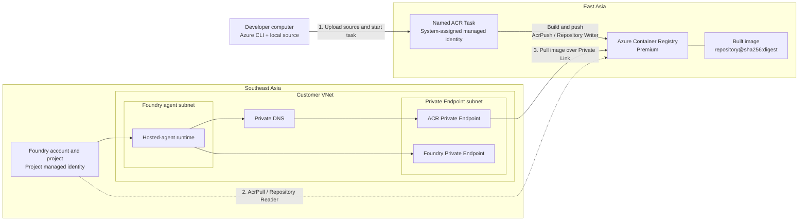

# Microsoft Foundry Cross-Region ACR Build and Pull

## Project objective

Build a container image from a developer's local source code by using an Azure
Container Registry Task in **East Asia**, then allow a Microsoft Foundry hosted
agent in **Southeast Asia** to pull that image privately.

The complete flow is:

```text
Local developer computer
    -> upload local source context
    -> named ACR Task
    -> remote container build
    -> push image into East Asia ACR
    -> Foundry project managed identity
    -> pull image through Private Link
    -> Foundry hosted-agent runtime in Southeast Asia
```

## End-to-end architecture



## Identities and permissions

There are three different actors. Do not use one broad role for all of them.

| Actor | Purpose | ACR role |
|---|---|---|
| Developer | Upload local source, create or run ACR Tasks, read build logs | `Container Registry Tasks Contributor` |
| ACR Task system-assigned managed identity | Pull base images when required and push the built image | `AcrPush` or `Container Registry Repository Writer` |
| Foundry project managed identity | Pull the completed image | `AcrPull` or `Container Registry Repository Reader` |

### Role selection

| ACR permission mode | Task build output role | Foundry pull role |
|---|---|---|
| RBAC Registry Permissions | `AcrPush` | `AcrPull` |
| RBAC Registry + ABAC Repository Permissions | `Container Registry Repository Writer` | `Container Registry Repository Reader` |

For ABAC mode, add repository conditions when access should be limited to a
specific repository.

The task identity needs **push/write**, not only pull/read, because it must
store the newly built image in ACR. The Foundry identity only needs
**pull/read**.

If the Dockerfile uses a base image from a different private registry, also
grant the task identity `AcrPull` or `Container Registry Repository Reader` on
that source registry.

## Network paths

The solution contains two independent network paths.

### Build path

```text
Developer
    -> Azure management and ACR Task source-upload endpoints
    -> Microsoft-managed ACR Task compute
    -> East Asia ACR
```

For a network-restricted registry, choose one of these options:

1. Allow the named task's system-assigned managed identity to use the ACR Task
   network bypass.
2. Run the task in a dedicated ACR agent pool connected to an approved VNet.

This guide uses the first option. The task build traffic does not pass through
the Foundry VNet or the Foundry-side ACR Private Endpoint.

### Runtime pull path

```text
Foundry hosted-agent runtime
    -> Foundry injected subnet
    -> Private DNS
    -> ACR Private Endpoint
    -> Azure Private Link
    -> East Asia ACR
```

ACR uses Private Endpoint, not VNet injection. VNet injection applies to the
Foundry hosted-agent runtime.

## Prerequisites

### Local computer

- Azure CLI installed.
- Access to the Azure subscription.
- A local source folder containing a valid `Dockerfile`.
- Permission to create and run ACR Tasks.

Confirm the local setup:

```powershell
az version
az login
az account show --output table
```

### Azure permissions

The configuration owner requires:

- Permission to create ACR, Foundry, VNet, subnets, Private Endpoints, and
  Private DNS resources.
- `Owner` or `Role Based Access Control Administrator` at the required scope
  to create role assignments.

## Implementation

### 1. Define the resource values

The examples use PowerShell:

```powershell
$subscriptionId = '<subscription-id>'
$acrResourceGroup = '<acr-resource-group>'
$acrName = '<globally-unique-acr-name>'
$taskName = 'foundry-agent-build'
$imageRepository = 'foundry/hosted-agent'
$sourcePath = 'C:\path\to\local\source'

az account set --subscription $subscriptionId
```

Example regional design:

| Resource | Region |
|---|---|
| Azure Container Registry | East Asia |
| Named ACR Task | Runs from the ACR home region |
| Foundry account and project | Southeast Asia |
| Foundry VNet | Southeast Asia |
| ACR Private Endpoint | Southeast Asia VNet |

### 2. Create the East Asia ACR

In **Azure portal**:

1. Create an Azure Container Registry in East Asia.
2. Select the **Premium** SKU.
3. Keep **Admin user** disabled.
4. Under **Settings > Properties**, record the role-assignment permission
   mode.
5. Under **Settings > Networking**, allow trusted Microsoft services.
6. Do not add a Southeast Asia geo-replica if the objective is to demonstrate
   a cross-region pull from the East Asia registry.

Premium SKU is required for Private Endpoint support.

### 3. Grant the developer ACR Task permission

From **ACR > Access control (IAM)**:

1. Select **Add role assignment**.
2. Select `Container Registry Tasks Contributor`.
3. Assign it to the developer or development group.
4. Scope it to this ACR.

This role includes the operations required to:

- Request a source upload URL.
- Upload the local source context.
- Schedule and run the task.
- Read task runs and streamed logs.

Treat this as a privileged build role because a user who can author and run
tasks can execute build instructions.

### 4. Prepare the Southeast Asia network

In **Azure portal > Virtual networks**:

1. Create a VNet in Southeast Asia.
2. Create a Foundry agent subnet.
3. Delegate the agent subnet to `Microsoft.App/environments`.
4. Use `/27` or larger.
5. Create a separate, nondelegated subnet for Private Endpoints.
6. Ensure the address ranges do not overlap connected VNets, VPNs, or
   ExpressRoute networks.

Example:

| Resource | Example |
|---|---|
| VNet | `vnet-foundry-sea-001` |
| Address space | `10.20.0.0/16` |
| Foundry agent subnet | `10.20.1.0/24` |
| Private Endpoint subnet | `10.20.2.0/24` |

### 5. Create Foundry with VNet injection

In **Azure portal**, search for **Foundry** and create the account:

1. Select Southeast Asia.
2. Configure the storage resources required by Agent Service.
3. Under **Network**, configure the Foundry Private Endpoint.
4. Place the Private Endpoint in the dedicated Private Endpoint subnet.
5. Enable private DNS integration.
6. Enable **Virtual network injection**.
7. Select the subnet delegated to `Microsoft.App/environments`.
8. Create the Foundry project.
9. Record the project managed identity object ID.

> [!IMPORTANT]
> Foundry network injection must be configured during account creation. It
> cannot currently be added later for hosted agents.

For an ACR with public network access disabled, use a Foundry project created
after **June 25, 2026**. Earlier projects require the ACR public endpoint.

### 6. Create the ACR Private Endpoint

From **ACR > Settings > Networking > Private access**:

1. Select **Create a private endpoint connection**.
2. Create the endpoint in Southeast Asia.
3. Select the Foundry VNet.
4. Select the dedicated Private Endpoint subnet.
5. Keep the target subresource as `registry`.
6. Enable integration with `privatelink.azurecr.io`.
7. Create the endpoint.
8. Confirm that the connection state is **Approved**.

The Private Endpoint is in Southeast Asia, but it does not move or replicate
the ACR. The registry and image data remain in East Asia.

### 7. Verify ACR Private DNS

1. Open the ACR Private Endpoint.
2. Select **Settings > DNS configuration**.
3. Confirm private IP configurations exist for the registry login endpoint and
   East Asia data endpoint.
4. Open the `privatelink.azurecr.io` Private DNS zone.
5. Confirm the zone is linked to the Foundry VNet.
6. Confirm the generated A records point to the Private Endpoint IPs.

The consumer network must resolve:

```text
<acr-name>.azurecr.io
<acr-name>.eastasia.data.azurecr.io
```

If custom DNS servers are used, configure conditional forwarding to Azure DNS.

### 8. Create the named ACR Task

From the local source folder:

```powershell
Set-Location $sourcePath

$runTag = "$imageRepository" + ':{{.Run.ID}}'
$latestTag = "$imageRepository" + ':latest'

az acr task create `
  --registry $acrName `
  --name $taskName `
  --context . `
  --file Dockerfile `
  --image $runTag `
  --image $latestTag `
  --assign-identity '[system]' `
  --commit-trigger-enabled false
```

This creates a reusable named task with a system-assigned managed identity. The
initial local source context is uploaded during task creation.

The run-specific tag preserves a unique build result. The `latest` tag is
convenient for looking up the most recent digest, but Foundry should use the
immutable digest rather than the mutable tag.

### 9. Grant the ACR Task identity push access

Get the task identity and ACR resource IDs:

```powershell
$taskPrincipalId = az acr task show `
  --registry $acrName `
  --name $taskName `
  --query identity.principalId `
  --output tsv

$acrId = az acr show `
  --resource-group $acrResourceGroup `
  --name $acrName `
  --query id `
  --output tsv
```

For an ACR using **RBAC Registry Permissions**:

```powershell
az role assignment create `
  --assignee-object-id $taskPrincipalId `
  --assignee-principal-type ServicePrincipal `
  --role AcrPush `
  --scope $acrId
```

For an ACR using **RBAC Registry + ABAC Repository Permissions**:

```powershell
az role assignment create `
  --assignee-object-id $taskPrincipalId `
  --assignee-principal-type ServicePrincipal `
  --role 'Container Registry Repository Writer' `
  --scope $acrId
```

Add an ABAC repository condition if required by customer policy.

Configure the task to use its system identity for the ACR credential:

```powershell
$acrLoginServer = "$acrName.azurecr.io"

az acr task credential add `
  --registry $acrName `
  --name $taskName `
  --login-server $acrLoginServer `
  --use-identity '[system]'
```

If the Dockerfile pulls a private base image from an ABAC-enabled ACR, configure
the task source-registry identity as well:

```powershell
az acr task update `
  --registry $acrName `
  --name $taskName `
  --source-acr-auth-id '[system]'
```

### 10. Enable ACR Task network bypass

This step is required when:

- The ACR is network restricted.
- The task runs on Microsoft-managed ACR Task compute.
- The task authenticates with its system-assigned managed identity.

Allow trusted Microsoft services in the ACR Networking page, then explicitly
enable the task bypass policy:

```powershell
az resource update `
  --namespace Microsoft.ContainerRegistry `
  --resource-type registries `
  --name $acrName `
  --resource-group $acrResourceGroup `
  --api-version 2025-06-01-preview `
  --set properties.networkRuleBypassAllowedForTasks=true
```

Verify it:

```powershell
az resource show `
  --namespace Microsoft.ContainerRegistry `
  --resource-type registries `
  --name $acrName `
  --resource-group $acrResourceGroup `
  --api-version 2025-06-01-preview `
  --query properties.networkRuleBypassAllowedForTasks
```

The expected result is `true`.

As of June 1, 2025, the default is to deny this bypass. A missing or false
setting can cause the task to fail with `403 Forbidden`.

If the customer does not allow trusted-service bypass, use a dedicated ACR
agent pool with approved VNet connectivity instead.

### 11. Upload the latest local source and run the task

Each time the developer wants to build the current local source:

```powershell
Set-Location $sourcePath

az acr task run `
  --registry $acrName `
  --name $taskName `
  --context . `
  --file Dockerfile
```

The `--context .` option uploads the current local directory and overrides the
context stored when the task was created. The command streams the remote build
logs to the developer's terminal.

The expected sequence is:

1. Azure CLI packages the local source context.
2. The source context is uploaded for the task run.
3. ACR Task compute starts the remote build.
4. The task identity authenticates to ACR.
5. The Dockerfile is executed.
6. The completed image is pushed to the configured repository.
7. A run-specific tag and `latest` tag are created.

### 12. Resolve the immutable image digest

After a successful task run:

```powershell
$digest = az acr repository show `
  --name $acrName `
  --image ($imageRepository + ':latest') `
  --query digest `
  --output tsv

$immutableImage = "$acrName.azurecr.io/$imageRepository@$digest"
$immutableImage
```

Expected format:

```text
<acr-name>.azurecr.io/foundry/hosted-agent@sha256:<digest>
```

Use this digest-pinned value for the Foundry deployment.

### 13. Grant the Foundry project pull access

From **ACR > Access control (IAM)**:

1. Select **Add role assignment**.
2. Choose:
   - `AcrPull` for RBAC Registry Permissions; or
   - `Container Registry Repository Reader` for RBAC + ABAC Repository
     Permissions.
3. Select **Managed identity**.
4. Select the Foundry project managed identity.
5. Assign the role at ACR scope.
6. For ABAC mode, add a condition for the image repository if required.
7. Allow time for role propagation.

The Foundry identity does not need `AcrPush`, `Contributor`, or `Owner`.

### 14. Create the Foundry ACR connection

In the Foundry project:

1. Open the project management center.
2. Select **Connected resources** or **Connections**.
3. Add an **Azure Container Registry** connection.
4. Select the East Asia ACR.
5. Select project managed identity authentication.
6. Save the connection.

The connection identifies the registry. It does not create the ACR Private
Endpoint, Private DNS records, or ACR role assignment.

### 15. Disable ACR public network access

After the build path and private pull path have been configured:

1. Open **ACR > Settings > Networking > Public access**.
2. Set public network access to **Disabled**.
3. Save.
4. Confirm the approved Private Endpoint remains available.
5. Confirm trusted Microsoft services and the ACR Task bypass policy match the
   selected build design.

Repository browsing from a workstation outside the VNet might stop working.
This is expected.

### 16. Configure Foundry to use the built image

Use the immutable image value from step 12:

```text
<acr-name>.azurecr.io/<repository>@sha256:<digest>
```

Create or update the customer-owned hosted-agent version with that image, then
start the hosted agent.

At runtime:

1. Foundry uses the project managed identity.
2. Private DNS resolves the ACR names to Private Endpoint IPs.
3. The runtime reaches ACR through Azure Private Link.
4. ACR checks the Foundry identity's pull role.
5. The image manifest and layers are downloaded from East Asia.

## End-to-end verification

### Build verification

Confirm:

- The developer can start the named task.
- The task run shows `Succeeded`.
- Build logs show the image push.
- ACR contains the run-specific tag and `latest`.
- The task uses a system-assigned managed identity.
- The task identity has `AcrPush` or Repository Writer.

Useful commands:

```powershell
az acr task show `
  --registry $acrName `
  --name $taskName `
  --output table

az acr task list-runs `
  --registry $acrName `
  --name $taskName `
  --output table

az acr repository show-tags `
  --name $acrName `
  --repository $imageRepository `
  --detail `
  --output table
```

### Foundry pull verification

Confirm:

- ACR public network access remains disabled.
- The ACR Private Endpoint is approved.
- ACR names resolve to private IP addresses from the Foundry network.
- The Foundry project identity has only pull/read permission.
- The Foundry ACR connection points to the correct registry.
- The hosted-agent version references the expected SHA-256 digest.
- The hosted-agent revision starts successfully.

## Troubleshooting

Check failures according to the stage where they occur.

| Stage | Symptom | Check |
|---|---|---|
| Source upload | `listBuildSourceUploadUrl` or `scheduleRun` returns 403 | Developer has `Container Registry Tasks Contributor` |
| Task start | Task cannot be scheduled | Task is enabled and developer has task permission |
| Task registry login | 401 or 403 | Task credential uses `[system]`; role assignment has propagated |
| Task network access | 403 with network policy | Trusted services and `networkRuleBypassAllowedForTasks=true` |
| Base image pull | Unauthorized | Task identity has reader/pull role on the base-image registry |
| Built image push | Unauthorized | Task identity has `AcrPush` or Repository Writer |
| Image lookup | Tag or digest not found | Task output repository and task run logs |
| Foundry DNS | ACR resolves publicly or not at all | Private DNS records, VNet link, and custom DNS forwarding |
| Foundry network | Timeout | Private Endpoint approval, NSG, UDR, firewall, and TCP 443 |
| Foundry image pull | 401 or 403 | Foundry project identity and `AcrPull`/Repository Reader |
| Foundry starts old image | Unexpected image content | Use `repository@sha256:digest`, not only `:latest` |

## Microsoft references

- [ACR Tasks overview and source context locations](https://learn.microsoft.com/azure/container-registry/container-registry-tasks-overview)
- [Use a managed identity in ACR Tasks](https://learn.microsoft.com/azure/container-registry/container-registry-tasks-authentication-managed-identity)
- [Manage network bypass policy for ACR Tasks](https://learn.microsoft.com/azure/container-registry/manage-network-bypass-policy-for-tasks)
- [Container Registry Tasks Contributor role](https://learn.microsoft.com/azure/role-based-access-control/built-in-roles/containers#container-registry-tasks-contributor)
- [Connect privately to an Azure container registry](https://learn.microsoft.com/azure/container-registry/container-registry-private-endpoints)
- [Azure Container Registry roles and permissions](https://learn.microsoft.com/azure/container-registry/container-registry-roles)
- [ACR RBAC and ABAC repository permissions](https://learn.microsoft.com/azure/container-registry/container-registry-rbac-abac-repository-permissions)
- [Configure private networking for Foundry Agent Service](https://learn.microsoft.com/azure/foundry/agents/how-to/virtual-networks)
- [Hosted agent permissions reference](https://learn.microsoft.com/azure/foundry/agents/concepts/hosted-agent-permissions)
- [Deploy a hosted agent with a private Azure Container Registry](https://learn.microsoft.com/azure/foundry/agents/how-to/deploy-hosted-agent-private-azure-container-registry)
