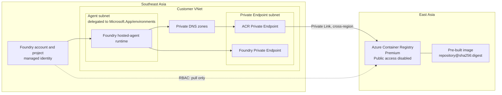

# ACR Cross-Region Pull Drill for Microsoft Foundry

A portal-first configuration guide for validating that a Microsoft Foundry
hosted agent in **Southeast Asia** can pull a pre-built container image from an
Azure Container Registry (ACR) whose only registry region is **East Asia**.

This repository contains documentation only. It intentionally does **not**
contain application code, a Dockerfile, infrastructure-as-code, build scripts,
or deployment automation.

> [!IMPORTANT]
> The drill starts with a valid hosted-agent image already present in ACR.
> Building, pushing, scanning, signing, and deploying the agent application are
> owned by the customer's application or platform team and are out of scope.

## Table of contents

- [1. Drill objective](#1-drill-objective)
- [2. Scope and success criteria](#2-scope-and-success-criteria)
- [3. Reference architecture](#3-reference-architecture)
- [4. Core concepts](#4-core-concepts)
- [5. Prerequisites and required information](#5-prerequisites-and-required-information)
- [6. Portal configuration runbook](#6-portal-configuration-runbook)
- [7. Validation and evidence](#7-validation-and-evidence)
- [8. Failure drills](#8-failure-drills)
- [9. Troubleshooting](#9-troubleshooting)
- [10. Security and production considerations](#10-security-and-production-considerations)
- [11. Cleanup](#11-cleanup)
- [12. Official Microsoft references](#12-official-microsoft-references)

## 1. Drill objective

Prove the following path without opening ACR to the public internet:

```text
Foundry hosted-agent runtime (Southeast Asia)
    -> Foundry injected subnet
    -> Private DNS
    -> ACR Private Endpoint NIC (Southeast Asia VNet)
    -> Azure Private Link
    -> ACR registry and image data (East Asia)
```

The test deliberately uses an ACR with **no Southeast Asia geo-replica**. A
successful pull therefore demonstrates access to the East Asia registry across
regions.

### What this drill does not prove

- It does not benchmark image-pull latency or throughput.
- It does not test application behavior after the container starts.
- It does not validate a build or image-push pipeline.
- It does not simulate an Azure regional outage.
- It does not validate ACR geo-replication.

## 2. Scope and success criteria

### In scope

- Azure portal configuration of ACR, VNet, subnets, Private Endpoint, and
  Private DNS.
- Foundry network injection and project managed identity.
- ACR pull authorization through Azure RBAC.
- Foundry-to-ACR connection metadata.
- A controlled pull, negative tests, and evidence collection.

### Out of scope

- Source code and Dockerfile authoring.
- Image build, push, signing, and vulnerability scanning.
- `azd`, Azure CLI, PowerShell, Bicep, or Terraform deployment.
- Model selection and application-level agent configuration.
- Production landing-zone design.

### Success criteria

The drill passes only when all of the following are true:

1. The Foundry project was created **after June 25, 2026** if ACR public
   network access is disabled.
2. ACR public network access is disabled.
3. ACR has a single registry region: East Asia.
4. The ACR Private Endpoint is approved and placed in the Southeast Asia VNet.
5. The Foundry runtime has network injection into the delegated subnet.
6. ACR names resolve privately from the consumer network.
7. The Foundry project managed identity has pull-only data-plane permission.
8. The customer-supplied hosted-agent deployment can pull the pre-built image.
9. Removing either DNS/network access or RBAC makes the pull fail as expected.

## 3. Reference architecture



### Suggested naming and address plan

| Item | Example |
|---|---|
| Foundry region | Southeast Asia |
| ACR home region | East Asia |
| VNet | `vnet-foundry-sea-001` |
| VNet address space | `10.20.0.0/16` |
| Foundry injected subnet | `snet-foundry-agent` (`10.20.1.0/24`) |
| Private Endpoint subnet | `snet-private-endpoints` (`10.20.2.0/24`) |
| ACR Private Endpoint | `pe-acr-crossregion-sea-001` |
| ACR Private DNS zone | `privatelink.azurecr.io` |

Use customer-approved names and nonoverlapping CIDR ranges.

## 4. Core concepts

### 4.1 Four independent controls

| Question | Control | What success means |
|---|---|---|
| Can traffic reach ACR? | VNet injection, route, NSG/firewall, Private Endpoint | TCP 443 can reach ACR through Private Link |
| Does the name resolve correctly? | Private DNS zone and VNet link | ACR FQDN resolves to the Private Endpoint's private IP |
| Who is calling? | Microsoft Entra managed identity | Foundry presents the intended project identity |
| What can the caller do? | ACR data-plane RBAC | The identity can pull, but cannot push or administer ACR |

A connection object or role assignment cannot repair broken routing or DNS.
Likewise, network reachability does not grant authorization.

### 4.2 Cross-region pull versus geo-replication

This drill uses **one ACR region** and accesses it from a workload in another
region. That is a cross-region pull.

ACR geo-replication is different:

- It requires Premium SKU.
- It creates active, writable replicas in selected Azure regions.
- Images and metadata replicate with eventual consistency.
- The global endpoint normally routes to the replica with the best network
  profile, which is often the closest healthy replica.

Do not add a Southeast Asia ACR replica during the base drill. If one is added,
a successful pull might be served locally and no longer proves the intended
East Asia path.

### 4.3 Private Endpoint is not VNet injection

- **ACR uses Private Endpoint/Private Link.** A private IP is allocated in the
  consumer VNet for the ACR service.
- **Foundry hosted agents use VNet injection.** Runtime compute is attached to
  a subnet delegated to `Microsoft.App/environments`.
- ACR is not injected into the VNet.
- A Private Endpoint does not move or replicate the ACR data into Southeast
  Asia. It is a private network interface to the East Asia service.

Use separate subnets. Do not place Private Endpoints in the delegated Foundry
agent subnet.

### 4.4 Private DNS

The ACR Private Endpoint uses the private DNS zone:

```text
privatelink.azurecr.io
```

For an East Asia registry, verify records that support both the registry login
endpoint and the East Asia data endpoint:

```text
<registry>.azurecr.io
<registry>.eastasia.data.azurecr.io
```

The normal ACR hostname remains in the image reference. Private DNS changes
where that hostname resolves; customers should not place the
`privatelink.azurecr.io` name in the image reference.

### 4.5 Identity and RBAC

Use the Foundry **project managed identity**, not the registry admin account.
Keep ACR admin user disabled.

The correct pull role depends on the ACR role-assignment permission mode:

| ACR permission mode | Pull role at ACR scope |
|---|---|
| RBAC Registry Permissions | `AcrPull` |
| RBAC Registry + ABAC Repository Permissions | `Container Registry Repository Reader` |

For ABAC mode, optionally add a condition that limits access to the required
repository. `Owner`, `Contributor`, and `Reader` are management-plane roles and
do not by themselves grant image pull access.

The human creating role assignments needs `Owner` or `Role Based Access
Control Administrator` at the ACR scope or a suitable parent scope.

### 4.6 Foundry ACR connection

The project ACR connection tells Foundry which registry to use and that the
project managed identity is the authentication method. It does **not** create:

- A Private Endpoint.
- Private DNS records.
- Network routes.
- ACR pull permission.

All four elements must be configured separately.

### 4.7 Tags and digests

For the final customer-supplied deployment, prefer an immutable image:

```text
<registry>.azurecr.io/<repository>@sha256:<digest>
```

A mutable tag can point to different content later and weakens the evidence
collected from the drill.

## 5. Prerequisites and required information

### Azure resources and permissions

- An Azure subscription that supports Microsoft Foundry hosted agents.
- Permission to create Foundry, ACR Premium, VNet, subnets, Private Endpoints,
  Private DNS zones, and role assignments.
- A customer-approved Foundry region and ACR region.
- A **Premium** ACR in East Asia, or permission to create one.
- A pre-built hosted-agent image already stored in that ACR.
- The image repository, tag, and preferably SHA-256 digest.

### Record these values before starting

| Value | Customer value |
|---|---|
| Subscription | |
| Resource groups | |
| Foundry account | |
| Foundry project | |
| Foundry project creation date | |
| Foundry project managed identity object ID | |
| ACR name | |
| ACR home region | East Asia |
| ACR role-assignment permission mode | |
| Image repository and digest | |
| VNet and subnet CIDRs | |

> [!WARNING]
> Current Microsoft guidance states that Foundry hosted-agent projects created
> after June 25, 2026 support ACR behind a Private Endpoint with public network
> access disabled. Projects created before that date require the ACR public
> endpoint. Create a new project for this private-path drill if necessary.

## 6. Portal configuration runbook

### Step 1 - Confirm the pre-built image

In **Azure portal**:

1. Open the East Asia container registry.
2. Select **Services > Repositories**.
3. Open the required repository and tag.
4. Record the manifest digest.
5. Confirm the image is compatible with the hosted-agent runtime.

Do not build or push an image as part of this repository's procedure.

### Step 2 - Confirm ACR settings

Open the registry and verify:

1. **Overview > Location** is **East Asia**.
2. **Settings > Replications** has no Southeast Asia replica.
3. **Settings > Properties**:
   - SKU is **Premium**.
   - Admin user is **Disabled**.
   - Record the **Role assignment permissions mode**.
   - Microsoft Entra authentication as ARM policy is enabled where exposed.
4. Leave public access enabled temporarily only if an existing approved
   process still needs it. It will be disabled after private-path validation.

### Step 3 - Create the Southeast Asia VNet

In **Azure portal > Virtual networks**:

1. Create a VNet in Southeast Asia with a nonoverlapping address space.
2. Create `snet-foundry-agent`.
3. Delegate `snet-foundry-agent` to `Microsoft.App/environments`.
4. Use `/27` or larger; `/24` is recommended for a drill with room for
   overlapping revisions.
5. Create `snet-private-endpoints`.
6. Do not delegate the Private Endpoint subnet.
7. Review NSGs, UDRs, Azure Firewall, DNS forwarders, and TLS inspection.
   Permit required Foundry and Microsoft Entra dependencies over TCP 443.

### Step 4 - Create Foundry with network injection

Network injection must be selected when the Foundry account is first created;
it cannot currently be added later for hosted agents.

1. In **Azure portal**, search for **Foundry** and select **Create**.
2. Complete **Basics** and choose Southeast Asia.
3. On **Storage**, select the customer-approved resources required by Agent
   Service.
4. On **Network**, disable public access if required by the customer design.
5. Add a Foundry Private Endpoint:
   - Region: Southeast Asia.
   - VNet: the drill VNet.
   - Subnet: `snet-private-endpoints`.
   - Target subresource: `account`.
   - Enable private DNS integration.
6. For **Virtual network injection**, select:
   - The drill VNet.
   - `snet-foundry-agent`.
7. Review and create the Foundry account and project.
8. Confirm the project creation date is after June 25, 2026.
9. Record the project managed identity object ID.

If a user-assigned managed identity is required, choose it during project
creation. Changing the project identity type later is not currently supported.

### Step 5 - Create the cross-region ACR Private Endpoint

From the East Asia ACR:

1. Select **Settings > Networking > Private access**.
2. Select **Create a private endpoint connection**.
3. On **Basics**:
   - Place the Private Endpoint in Southeast Asia.
   - Use the network resource group.
4. On **Resource**, keep target subresource `registry`.
5. On **Virtual network**:
   - Select the Southeast Asia drill VNet.
   - Select `snet-private-endpoints`.
6. On **DNS**:
   - Set **Integrate with private DNS zone** to **Yes**.
   - Select or create `privatelink.azurecr.io`.
7. Create the endpoint.
8. Confirm its connection state is **Approved**.

The Private Endpoint's region follows its VNet, not the ACR home region. This
does not create an ACR replica.

### Step 6 - Verify Private DNS

1. Open the ACR Private Endpoint.
2. Select **Settings > DNS configuration**.
3. Confirm private IP configurations exist for the registry and East Asia data
   endpoint.
4. Open **Private DNS zones > privatelink.azurecr.io**.
5. Confirm the zone is linked to the Foundry VNet.
6. Confirm A records exist for the registry and its East Asia data endpoint.
7. If the customer uses custom DNS, configure conditional forwarding to Azure
   DNS and verify that the CNAME chain ends at the Private Endpoint IP.

Expected behavior from the consumer network:

```text
<registry>.azurecr.io
  -> <registry>.privatelink.azurecr.io
  -> 10.20.2.x

<registry>.eastasia.data.azurecr.io
  -> <registry>.eastasia.data.privatelink.azurecr.io
  -> 10.20.2.y
```

Exact record labels and IP allocation are generated by Azure; use the Private
Endpoint's **DNS configuration** blade as the source of truth.

### Step 7 - Grant least-privilege ACR pull access

1. Open the ACR.
2. Select **Access control (IAM) > Add > Add role assignment**.
3. Choose the role that matches the registry mode:
   - `AcrPull` for legacy RBAC Registry Permissions.
   - `Container Registry Repository Reader` for RBAC + ABAC Repository
     Permissions.
4. For **Assign access to**, select **Managed identity**.
5. Select the Foundry project managed identity.
6. Scope the assignment to the ACR resource.
7. For ABAC mode, add a repository condition if the customer requires
   repository-level isolation.
8. Save and allow time for role propagation.

Do not grant `AcrPush`, `Contributor`, or `Owner` to the runtime identity.

### Step 8 - Confirm Foundry account and project roles

From the Foundry account's **Access control (IAM)**:

1. Confirm the project managed identity has **Foundry User** at Foundry account
   scope. This is normally created automatically when the project creator can
   create role assignments.
2. Confirm the customer operator has only the roles needed to create the
   project and connection.
3. Record role assignment screenshots or exports for the evidence pack.

### Step 9 - Create the Foundry ACR connection

In the Foundry project:

1. Open the project's management center.
2. Select **Connected resources** or **Connections**.
3. Create a connection of category **Azure Container Registry**.
4. Select the existing East Asia ACR.
5. Select project managed identity authentication.
6. Save the connection.
7. Confirm the connection shows the expected ACR resource ID and login server.

Portal labels can change during Foundry updates. The required end state is a
project-scoped ACR connection using the project managed identity.

### Step 10 - Disable ACR public network access

After Private Endpoint, DNS, and RBAC are ready:

1. Open **ACR > Settings > Networking > Public access**.
2. Set public network access to **Disabled**.
3. Save.
4. Confirm the approved Private Endpoint remains listed.

After this change, repository and tag browsing from a workstation outside the
VNet can fail by design. That does not mean the private pull path is broken.

### Step 11 - Trigger the customer-owned pull

The application owner now deploys or restarts the hosted-agent version that
references:

```text
<registry>.azurecr.io/<repository>@sha256:<digest>
```

No build or deployment commands are provided in this repository. The drill
owner observes the pull result and collects platform evidence.

## 7. Validation and evidence

### Pre-pull checklist

- [ ] ACR is Premium and located in East Asia.
- [ ] No Southeast Asia ACR geo-replica exists.
- [ ] ACR admin user is disabled.
- [ ] ACR public network access is disabled.
- [ ] Foundry project creation date is after June 25, 2026.
- [ ] Foundry uses the Southeast Asia injected subnet.
- [ ] ACR Private Endpoint is approved in the Southeast Asia VNet.
- [ ] `privatelink.azurecr.io` is linked to that VNet.
- [ ] Registry and East Asia data endpoint records resolve to private IPs.
- [ ] Project managed identity has the correct pull-only role.
- [ ] Foundry project has an ACR connection using managed identity.
- [ ] Deployment references an immutable image digest.

### Pass evidence

Collect:

1. ACR Overview showing East Asia.
2. ACR Replications showing no Southeast Asia replica.
3. ACR Networking showing public access disabled and the approved Private
   Endpoint.
4. Private Endpoint DNS configuration and private IPs.
5. Private DNS zone records and VNet link.
6. Foundry network injection and subnet delegation.
7. ACR IAM assignment for the project managed identity.
8. Foundry ACR connection details.
9. Hosted-agent deployment/revision status showing a successful image pull.
10. The exact image digest and UTC timestamps.

### Suggested result table

| Test | Expected | Actual | Evidence | Result |
|---|---|---|---|---|
| Baseline private pull | Image pull succeeds | | | |
| Public access disabled | Pull still succeeds | | | |
| Pull RBAC removed | Pull fails with authorization error | | | |
| RBAC restored | Pull succeeds after propagation | | | |
| Private DNS link removed | Pull fails with DNS/network error | | | |
| DNS link restored | Pull succeeds | | | |

## 8. Failure drills

Perform failure drills only in an approved nonproduction environment.

### Drill A - Remove pull authorization

1. Remove the project's ACR pull role assignment.
2. Wait for RBAC propagation.
3. Trigger a fresh revision or pull.
4. Expected result: authentication can occur, but authorization fails.
5. Restore the exact role assignment.
6. Confirm recovery.

This separates RBAC failure from networking failure.

### Drill B - Break Private DNS

1. Temporarily unlink `privatelink.azurecr.io` from the drill VNet.
2. Trigger a fresh pull.
3. Expected result: name resolution or network connection fails.
4. Restore the VNet link.
5. Confirm private resolution and pull recovery.

Do not replace this test by enabling ACR public access, because that creates a
different route and weakens the result.

### Drill C - Optional geo-replication extension

After the base drill passes, optionally:

1. Add a Southeast Asia ACR geo-replica.
2. Wait for replication to complete.
3. Review and approve any new Private Endpoint connection state if required.
4. Verify new data endpoint DNS records for the replica.
5. Repeat the pull and compare timing.

This extension validates geo-replication behavior, not the original
cross-region-only path. Remember that ACR replication is eventually
consistent.

## 9. Troubleshooting

Troubleshoot in this order: **DNS -> network -> identity -> authorization ->
image reference**.

| Symptom | Likely cause | Portal checks |
|---|---|---|
| Name resolves publicly | Missing private DNS VNet link or custom DNS forwarding | Private DNS zone links, DNS configuration, DNS forwarder |
| Registry login resolves privately but layer download fails | East Asia data endpoint DNS record or firewall rule is missing | ACR Private Endpoint DNS configuration and `*.data.azurecr.io` path |
| Timeout or connection refused | NSG, UDR, firewall, proxy, or TLS inspection blocks TCP 443 | Effective routes, NSG rules, firewall logs |
| `401` or authentication error | Wrong identity or Entra authentication policy | Foundry project identity and ACR authentication settings |
| `403` or unauthorized | Missing/wrong role, wrong ACR permission mode, ABAC condition mismatch | ACR IAM and Properties |
| `manifest unknown` | Wrong repository/tag/digest or image unavailable | ACR repository manifest and supplied digest |
| Portal cannot list repositories after public access is disabled | Operator workstation has no private route to ACR | Expected behavior; use an approved private administration path |
| Pull works only when public access is enabled | Private path is incomplete | Recheck PE approval, DNS, VNet injection, and project age limitation |

## 10. Security and production considerations

- Use managed identity; do not enable ACR admin credentials.
- Grant pull-only access at the narrowest practical scope.
- Use ABAC repository conditions when enterprise policy requires
  repository-level isolation.
- Pin deployments by digest.
- Keep separate subnets for injected runtime and Private Endpoints.
- Size the injected subnet for revisions and overlapping rollouts, not one
  container.
- Review forced tunneling, DNS proxies, outbound firewall rules, and TLS
  inspection against Foundry dependencies.
- Treat role assignment, connection metadata, Private Endpoint, and DNS as
  separate configuration items.
- Do not assume that Private Link makes data local to the Private Endpoint's
  region.
- Add geo-replication only when availability, latency, or data-residency design
  requires it, and account for eventual consistency.

## 11. Cleanup

After evidence is accepted:

1. Remove temporary role changes created for negative tests.
2. Remove the test Foundry ACR connection if it is no longer required.
3. Delete the ACR Private Endpoint and generated DNS records if they were
   drill-only.
4. Delete drill-only Private DNS VNet links and zones.
5. Delete the drill Foundry project/account and purge it if required.
6. Delete the VNet only after injected and Private Endpoint resources are gone.
7. Retain the evidence pack according to the customer's retention policy.

Do not delete shared ACR, network, DNS, or Foundry resources.

## 12. Official Microsoft references

- [Geo-replication in Azure Container Registry](https://learn.microsoft.com/azure/container-registry/container-registry-geo-replication)
- [Connect privately to an Azure container registry using Azure Private Link](https://learn.microsoft.com/azure/container-registry/container-registry-private-endpoints)
- [Azure Container Registry roles and permissions](https://learn.microsoft.com/azure/container-registry/container-registry-roles)
- [Azure Container Registry RBAC and ABAC repository permissions](https://learn.microsoft.com/azure/container-registry/container-registry-rbac-abac-repository-permissions)
- [Configure private networking for Foundry Agent Service](https://learn.microsoft.com/azure/foundry/agents/how-to/virtual-networks)
- [Hosted agent permissions reference](https://learn.microsoft.com/azure/foundry/agents/concepts/hosted-agent-permissions)
- [Deploy a hosted agent with a private Azure Container Registry](https://learn.microsoft.com/azure/foundry/agents/how-to/deploy-hosted-agent-private-azure-container-registry)
- [Azure Private Endpoint DNS configuration](https://learn.microsoft.com/azure/private-link/private-endpoint-dns)

---

**Document assumptions:** Microsoft Foundry hosted agent in Southeast Asia,
single-region Premium ACR in East Asia, project created after June 25, 2026,
and a customer-supplied pre-built image. Reconfirm product limitations and
portal labels in the official documentation before each customer drill.
