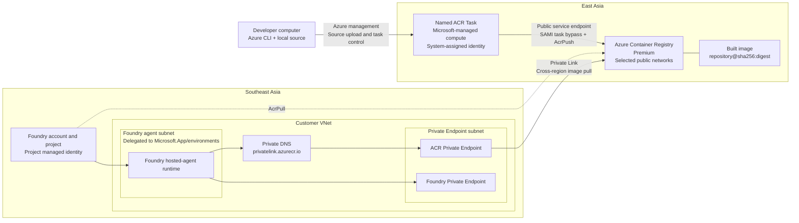
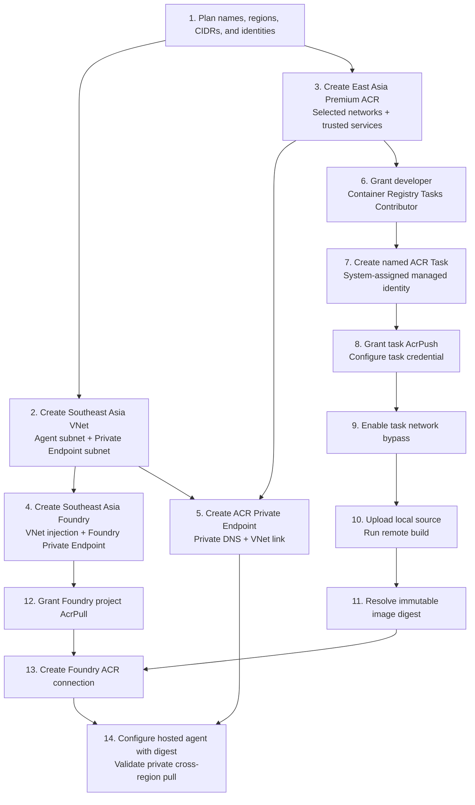

# Microsoft Foundry Cross-Region ACR Build and Pull

## Project objective

Build a container image from a developer's local source code by using an Azure
Container Registry (ACR) Task in **East Asia**, then allow a Microsoft Foundry
hosted agent in **Southeast Asia** to pull that image through Azure Private
Link.

The end-to-end flow is:

```text
Local developer computer
    -> upload local source context
    -> named ACR Task
    -> remote container build
    -> push image into East Asia ACR
    -> resolve immutable image digest
    -> Foundry project managed identity
    -> pull image through ACR Private Endpoint
    -> Foundry hosted-agent runtime in Southeast Asia
```

## Architecture



## Solution description

The design separates build-time access from runtime image pull access.

### Developer and source-upload path

The developer uses Azure CLI from an approved workstation. ACR public access is
restricted to **Selected networks**, and the workstation's public outbound IP
or corporate egress CIDR is allowlisted.

The developer uploads the local source context and controls the named ACR Task.
The developer receives `Container Registry Tasks Contributor` at the ACR
scope.

### ACR Task build path

The named ACR Task runs on Microsoft-managed ACR Task compute. It has a
system-assigned managed identity and receives `AcrPush` on the registry.

Because the registry is network restricted, the task uses:

- **Allow trusted Microsoft services**
- `networkRuleBypassAllowedForTasks=true`
- The task's system-assigned managed identity
- `AcrPush`

This path uses the ACR **public service endpoint with trusted-service bypass**.
It does not use the Foundry VNet or the ACR Private Endpoint.

If customer policy requires the build path itself to use private IPs, replace
the default task compute with an ACR Agent Pool or a self-hosted build runner
that has VNet access to the ACR Private Endpoint.

### Foundry runtime pull path

The Foundry hosted-agent runtime is injected into a subnet delegated to
`Microsoft.App/environments`. The runtime resolves the normal ACR login and
data endpoint names through the `privatelink.azurecr.io` Private DNS zone.

The Foundry project managed identity receives `AcrPull` on the registry. Image
manifests and layers are downloaded through the ACR Private Endpoint and Azure
Private Link.

The ACR Private Endpoint is located in the Southeast Asia VNet, but the
registry and image data remain in East Asia. The Private Endpoint does not
create a geo-replica.

## High-level configuration flow



## Configuration at a glance

| Component | Region/location | Required configuration | Identity and RBAC | Network path |
|---|---|---|---|---|
| Developer computer | Customer network | Azure CLI, local source, Dockerfile, fixed public egress IP where possible | `Container Registry Tasks Contributor` on ACR | Public Azure management/task endpoints; ACR Selected networks |
| Azure Container Registry | East Asia | Premium, admin disabled, RBAC Registry Permissions, selected public networks, trusted services | Target scope for developer, task, and Foundry roles | Public endpoint for developer/task; Private Endpoint for Foundry |
| Named ACR Task | ACR home region | Docker build definition, run-specific tag, `latest` tag, system-assigned identity | `AcrPush` on ACR | Public ACR service endpoint using SAMI task bypass |
| Foundry VNet | Southeast Asia | Nonoverlapping address space | Not applicable | Contains the injected runtime and Private Endpoints |
| Foundry agent subnet | Southeast Asia VNet | Dedicated subnet, `/27` or larger, delegated to `Microsoft.App/environments` | Foundry platform-managed placement | Hosted-agent runtime network injection |
| Private Endpoint subnet | Southeast Asia VNet | Separate, nondelegated subnet | Not applicable | Hosts ACR and Foundry Private Endpoint NICs |
| ACR Private Endpoint | Southeast Asia VNet | Target subresource `registry` | Private Endpoint approval | Azure Private Link to East Asia ACR |
| ACR Private DNS | Linked to Foundry VNet | `privatelink.azurecr.io`; registry and East Asia data records | Not applicable | Resolves ACR FQDNs to private IPs |
| Foundry account/project | Southeast Asia | Network injection selected at creation; ACR connection | Project identity: `Foundry User` on account and `AcrPull` on ACR | Runtime pulls through ACR Private Endpoint |
| Configuration owner | Azure management plane | Creates resources and role assignments | `Owner` or `Role Based Access Control Administrator` where assignments are created | Azure management plane |

## RBAC summary

This guide follows the verified **RBAC Registry Permissions** mode.

| Principal | Role | Scope | Reason |
|---|---|---|---|
| Developer or development group | `Container Registry Tasks Contributor` | ACR | Upload source context, create/run tasks, read runs and logs |
| ACR Task system-assigned identity | `AcrPush` | ACR | Pull required base content and push the built image |
| Foundry project managed identity | `AcrPull` | ACR | Pull the completed hosted-agent image |
| Foundry project managed identity | `Foundry User` | Foundry account | Use Foundry project and agent capabilities; normally assigned during project creation |
| Configuration owner | `Owner` or `Role Based Access Control Administrator` | Relevant scope | Create the preceding role assignments |

Do not replace these data-plane roles with broad management roles. A
management-plane `Contributor` assignment does not by itself grant ACR image
pull or push access.

If the Dockerfile pulls a base image from another private ACR, grant the task
identity `AcrPull` on that source registry as well.

## Network summary

| Flow | Endpoint type | Admission control | Authentication | Authorization |
|---|---|---|---|---|
| Developer to Azure/ACR Task | Public service endpoints | Developer public IP or corporate egress CIDR in Selected networks | Developer Microsoft Entra identity | `Container Registry Tasks Contributor` |
| ACR Task to ACR | Public ACR service endpoint | Trusted services + `networkRuleBypassAllowedForTasks=true` | Task system-assigned identity | `AcrPush` |
| Foundry runtime to ACR | Private Endpoint / Private Link | VNet injection, Private DNS, route and firewall policy | Foundry project managed identity | `AcrPull` |

Network admission, authentication, and authorization are independent checks.
For example, task bypass does not grant `AcrPush`, and `AcrPull` does not create
a Private Endpoint or DNS record.

## Prerequisites

### Local computer

- Azure CLI installed.
- Access to the target Azure subscription.
- A local source folder containing a valid `Dockerfile`.
- A known public outbound IPv4 address or corporate egress CIDR.
- Permission to create and run ACR Tasks.

Confirm the local setup:

```powershell
az version
az login
az account show --output table
```

### Azure permissions and capabilities

- Permission to create ACR, Foundry, VNet, subnets, Private Endpoints, and
  Private DNS resources.
- `Owner` or `Role Based Access Control Administrator` at the scope where role
  assignments are created.
- Premium ACR availability in East Asia.
- Microsoft Foundry hosted-agent availability in Southeast Asia.
- A Foundry project created after **June 25, 2026** for the supported private
  ACR path.

# Detailed implementation guidance

## Phase 1 - Foundation and private networking

### Step 1 - Define the resource values

The command examples use PowerShell:

```powershell
$subscriptionId = '<subscription-id>'
$acrResourceGroup = '<acr-resource-group>'
$acrName = '<globally-unique-acr-name>'
$taskName = 'foundry-agent-build'
$imageRepository = 'foundry/hosted-agent'
$sourcePath = 'C:\path\to\local\source'

az account set --subscription $subscriptionId
```

Regional design:

| Resource | Region |
|---|---|
| Azure Container Registry | East Asia |
| Named ACR Task | ACR home region |
| Foundry account and project | Southeast Asia |
| Foundry VNet | Southeast Asia |
| ACR Private Endpoint | Southeast Asia VNet |

### Step 2 - Create the Southeast Asia network

In **Azure portal > Virtual networks**:

1. Create a VNet in Southeast Asia.
2. Create a dedicated Foundry agent subnet.
3. Delegate the agent subnet to `Microsoft.App/environments`.
4. Use `/27` or larger.
5. Create a separate subnet for Private Endpoints.
6. Do not delegate the Private Endpoint subnet.
7. Confirm the address ranges do not overlap connected VNets, VPNs, or
   ExpressRoute networks.

Example:

| Resource | Example |
|---|---|
| VNet | `vnet-foundry-sea-001` |
| Address space | `10.20.0.0/16` |
| Foundry agent subnet | `10.20.1.0/24` |
| Private Endpoint subnet | `10.20.2.0/24` |

Review any NSGs, UDRs, Azure Firewall policies, DNS forwarders, and TLS
inspection before Foundry creation.

### Step 3 - Create and secure the East Asia ACR

In **Azure portal**:

1. Create an Azure Container Registry in East Asia.
2. Select the **Premium** SKU.
3. Keep **Admin user** disabled.
4. Under **Settings > Properties**, confirm **Role assignment permissions
   mode** is **RBAC Registry Permissions**.
5. Under **Settings > Networking > Public access**, select
   **Selected networks**.
6. Under **Firewall**, add the developer workstation's public outbound IPv4
   address or the corporate egress CIDR.
7. Prefer a `/32` rule for one fixed public IP.
8. Under **Firewall exception**, enable **Allow trusted Microsoft services to
   access this container registry**.
9. Save and allow several minutes for the rule to take effect.
10. Confirm no Southeast Asia geo-replica exists.

Use the public IP seen by Azure, not a local address such as `10.x.x.x` or
`192.168.x.x`. If the customer uses NAT, a proxy, or VPN internet breakout,
allowlist that public egress IP. Update the rule if it changes.

Premium SKU is required for ACR Private Endpoint support.

Foundry hosted agents require the registry's Microsoft Entra authentication as
ARM policy to be enabled. Check it:

```powershell
az acr config authentication-as-arm show `
  --registry $acrName
```

If required, enable it:

```powershell
az acr config authentication-as-arm update `
  --registry $acrName `
  --status enabled
```

### Step 4 - Create Foundry with VNet injection

In **Azure portal**, search for **Foundry** and create the account:

1. Select Southeast Asia.
2. Configure the storage resources required by Agent Service.
3. Under **Network**, configure the Foundry Private Endpoint.
4. Place the Private Endpoint in the dedicated Private Endpoint subnet.
5. Enable private DNS integration.
6. Enable **Virtual network injection**.
7. Select the subnet delegated to `Microsoft.App/environments`.
8. Create the Foundry project.
9. Record the project managed identity object ID.
10. Confirm the project identity has `Foundry User` on the Foundry account.

> [!IMPORTANT]
> Foundry network injection must be configured during account creation. It
> cannot currently be added later for hosted agents.

The Foundry runtime in this design uses the ACR Private Endpoint even though
selected public networks remain enabled for the developer workstation.

### Step 5 - Create the ACR Private Endpoint and DNS

From **ACR > Settings > Networking > Private access**:

1. Select **Create a private endpoint connection**.
2. Create the endpoint in Southeast Asia.
3. Select the Foundry VNet.
4. Select the dedicated Private Endpoint subnet.
5. Keep the target subresource as `registry`.
6. Enable integration with `privatelink.azurecr.io`.
7. Create the endpoint.
8. Confirm the connection state is **Approved**.

Then verify DNS:

1. Open the ACR Private Endpoint.
2. Select **Settings > DNS configuration**.
3. Confirm private IP configurations exist for the registry login endpoint and
   East Asia data endpoint.
4. Open the `privatelink.azurecr.io` Private DNS zone.
5. Confirm the zone is linked to the Foundry VNet.
6. Confirm the generated A records point to the Private Endpoint IPs.

The Foundry network must resolve:

```text
<acr-name>.azurecr.io
<acr-name>.eastasia.data.azurecr.io
```

If custom DNS servers are used, configure conditional forwarding to Azure DNS.

## Phase 2 - Configure and run the image build

### Step 6 - Grant the developer ACR Task permission

From **ACR > Access control (IAM)**:

1. Select **Add role assignment**.
2. Select `Container Registry Tasks Contributor`.
3. Assign it to the developer or development group.
4. Scope it to this ACR.

This role allows the developer to:

- Request a source upload URL.
- Upload the local source context.
- Create, schedule, and run ACR Tasks.
- Read task runs and streamed logs.

Treat this as a privileged build role because a user who can author and run
tasks can execute build instructions.

### Step 7 - Create the named ACR Task

Named task creation is performed with Azure CLI in this workflow because the
CLI packages and uploads the local source context.

From the local source folder:

```powershell
Set-Location $sourcePath

$runTag = "$imageRepository" + ':{{.Run.ID}}'
$latestTag = "$imageRepository" + ':latest'

az acr task create `
  --registry $acrName `
  --name $taskName `
  --context . `
  --file Dockerfile `
  --image $runTag `
  --image $latestTag `
  --assign-identity '[system]' `
  --commit-trigger-enabled false
```

This creates a reusable named task with a system-assigned managed identity. The
initial local source context is uploaded during task creation.

The run-specific tag preserves each build result. The `latest` tag is used only
to locate the newest digest; Foundry should use an immutable digest.

### Step 8 - Grant the task identity `AcrPush`

Get the task identity and ACR resource IDs:

```powershell
$taskPrincipalId = az acr task show `
  --registry $acrName `
  --name $taskName `
  --query identity.principalId `
  --output tsv

$acrId = az acr show `
  --resource-group $acrResourceGroup `
  --name $acrName `
  --query id `
  --output tsv
```

Assign `AcrPush`:

```powershell
az role assignment create `
  --assignee-object-id $taskPrincipalId `
  --assignee-principal-type ServicePrincipal `
  --role AcrPush `
  --scope $acrId
```

Configure the task to use its system identity for the registry credential:

```powershell
$acrLoginServer = "$acrName.azurecr.io"

az acr task credential add `
  --registry $acrName `
  --name $taskName `
  --login-server $acrLoginServer `
  --use-identity '[system]'
```

If the Dockerfile pulls a private base image from another ACR, grant the task
identity `AcrPull` on that source ACR and configure the corresponding task
credential.

### Step 9 - Enable the ACR Task network bypass

This design uses Microsoft-managed ACR Task compute. Its connection to ACR
uses the public service endpoint with an identity-aware trusted-service bypass;
it does not traverse the ACR Private Endpoint.

The trusted-services checkbox was enabled in step 3. Now explicitly enable the
task bypass policy:

```powershell
az resource update `
  --namespace Microsoft.ContainerRegistry `
  --resource-type registries `
  --name $acrName `
  --resource-group $acrResourceGroup `
  --api-version 2025-06-01-preview `
  --set properties.networkRuleBypassAllowedForTasks=true
```

Verify it:

```powershell
az resource show `
  --namespace Microsoft.ContainerRegistry `
  --resource-type registries `
  --name $acrName `
  --resource-group $acrResourceGroup `
  --api-version 2025-06-01-preview `
  --query properties.networkRuleBypassAllowedForTasks
```

The expected result is `true`.

As of June 1, 2025, task bypass is denied by default. A missing or false value
can cause a system-assigned-identity task to fail with `403 Forbidden`.

This flag bypasses network rules only. The task must still authenticate with
its system identity and must still have `AcrPush`.

If customer policy does not allow this public service endpoint bypass, use an
ACR Agent Pool or self-hosted runner connected to a VNet with access to the ACR
Private Endpoint.

### Step 10 - Upload the current source and run the build

Each time the developer wants to build the current local source:

```powershell
Set-Location $sourcePath

az acr task run `
  --registry $acrName `
  --name $taskName `
  --context . `
  --file Dockerfile
```

The `--context .` option uploads the current local directory and overrides the
context stored at task creation. The command streams the remote build logs.

Expected sequence:

1. Azure CLI packages the local source context.
2. The source context is uploaded for the task run.
3. Microsoft-managed ACR Task compute starts the remote build.
4. The task authenticates with its system-assigned identity.
5. The task bypasses the registry network rules.
6. The Dockerfile is executed.
7. The task uses `AcrPush` to write the image.
8. A run-specific tag and `latest` tag are created.

## Phase 3 - Configure the Foundry image pull

### Step 11 - Resolve the immutable image digest

After a successful build:

```powershell
$digest = az acr repository show `
  --name $acrName `
  --image ($imageRepository + ':latest') `
  --query digest `
  --output tsv

$immutableImage = "$acrName.azurecr.io/$imageRepository@$digest"
$immutableImage
```

Expected format:

```text
<acr-name>.azurecr.io/foundry/hosted-agent@sha256:<digest>
```

### Step 12 - Grant the Foundry project `AcrPull`

From **ACR > Access control (IAM)**:

1. Select **Add role assignment**.
2. Select `AcrPull`.
3. Select **Managed identity**.
4. Select the Foundry project managed identity.
5. Assign the role at ACR scope.
6. Allow time for role propagation.

The Foundry identity does not need `AcrPush`, `Contributor`, or `Owner`.

### Step 13 - Create the Foundry ACR connection

In the Foundry project:

1. Open the project management center.
2. Select **Connected resources** or **Connections**.
3. Add an **Azure Container Registry** connection.
4. Select the East Asia ACR.
5. Select project managed identity authentication.
6. Save the connection.

The connection identifies the registry. It does not create the ACR Private
Endpoint, Private DNS records, or `AcrPull` assignment.

### Step 14 - Configure and validate the hosted-agent image

Configure the customer-owned hosted-agent version with:

```text
<acr-name>.azurecr.io/<repository>@sha256:<digest>
```

Start or update the hosted-agent version.

At runtime:

1. Foundry uses the project managed identity.
2. The injected runtime resolves ACR names through Private DNS.
3. DNS returns the ACR Private Endpoint IPs.
4. The runtime reaches ACR through Azure Private Link.
5. ACR checks the project's `AcrPull` assignment.
6. The image manifest and layers are downloaded from East Asia.

## Phase 4 - End-to-end verification

### Foundation checks

- ACR is Premium and located in East Asia.
- ACR admin user is disabled.
- ACR uses RBAC Registry Permissions.
- Public access is restricted to Selected networks.
- The developer public egress IP or CIDR is allowlisted.
- Trusted Microsoft services are enabled.
- No Southeast Asia ACR geo-replica exists.
- Foundry network injection was selected at account creation.
- The ACR Private Endpoint is approved.
- `privatelink.azurecr.io` is linked to the Foundry VNet.

### Build checks

- The developer has `Container Registry Tasks Contributor`.
- The named task uses a system-assigned managed identity.
- The task identity has `AcrPush`.
- `networkRuleBypassAllowedForTasks` returns `true`.
- The task run shows `Succeeded`.
- ACR contains the run-specific tag and `latest`.

Useful commands:

```powershell
az acr task show `
  --registry $acrName `
  --name $taskName `
  --output table

az acr task list-runs `
  --registry $acrName `
  --name $taskName `
  --output table

az acr repository show-tags `
  --name $acrName `
  --repository $imageRepository `
  --detail `
  --output table
```

### Foundry pull checks

- The Foundry project identity has `AcrPull`.
- The Foundry ACR connection points to the correct registry.
- ACR names resolve to private IPs from the Foundry network.
- The hosted-agent version uses the expected SHA-256 digest.
- The hosted-agent revision starts successfully.
- ACR public access remains restricted to the approved developer network.

## Troubleshooting

Troubleshoot according to the stage that fails.

| Stage | Symptom | Check |
|---|---|---|
| Developer access | Portal/CLI access denied by firewall | Selected networks contains the developer's current public egress IP |
| Source upload | `listBuildSourceUploadUrl` or `scheduleRun` returns 403 | Developer has `Container Registry Tasks Contributor` |
| Task start | Task cannot be scheduled | Task is enabled and developer has task permission |
| Task registry login | 401 or 403 | Task credential uses `[system]`; role assignment has propagated |
| Task network access | 403 with network policy | Trusted services and `networkRuleBypassAllowedForTasks=true` |
| Base image pull | Unauthorized | Task identity has `AcrPull` on the private base-image registry |
| Built image push | Unauthorized | Task identity has `AcrPush` on the target ACR |
| Image lookup | Tag or digest not found | Task output repository and task run logs |
| Foundry DNS | ACR resolves publicly or not at all | Private DNS records, VNet link, and custom DNS forwarding |
| Foundry network | Timeout | Private Endpoint approval, NSG, UDR, firewall, and TCP 443 |
| Foundry image pull | 401 or 403 | Foundry project identity has `AcrPull` |
| Foundry starts old image | Unexpected image content | Use `repository@sha256:digest`, not only `:latest` |

## Microsoft references

- [ACR Tasks overview and source context locations](https://learn.microsoft.com/azure/container-registry/container-registry-tasks-overview)
- [Use a managed identity in ACR Tasks](https://learn.microsoft.com/azure/container-registry/container-registry-tasks-authentication-managed-identity)
- [Manage network bypass policy for ACR Tasks](https://learn.microsoft.com/azure/container-registry/manage-network-bypass-policy-for-tasks)
- [Allow trusted services to access a network-restricted ACR](https://learn.microsoft.com/azure/container-registry/allow-access-trusted-services)
- [Configure ACR access from selected public networks](https://learn.microsoft.com/azure/container-registry/container-registry-access-selected-networks)
- [Container Registry Tasks Contributor role](https://learn.microsoft.com/azure/role-based-access-control/built-in-roles/containers#container-registry-tasks-contributor)
- [Connect privately to an Azure container registry](https://learn.microsoft.com/azure/container-registry/container-registry-private-endpoints)
- [Azure Container Registry roles and permissions](https://learn.microsoft.com/azure/container-registry/container-registry-roles)
- [Configure private networking for Foundry Agent Service](https://learn.microsoft.com/azure/foundry/agents/how-to/virtual-networks)
- [Hosted agent permissions reference](https://learn.microsoft.com/azure/foundry/agents/concepts/hosted-agent-permissions)
- [Deploy a hosted agent with a private Azure Container Registry](https://learn.microsoft.com/azure/foundry/agents/how-to/deploy-hosted-agent-private-azure-container-registry)
