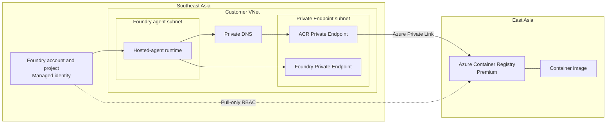

# Microsoft Foundry Cross-Region ACR Pull

## Project objective

Configure a Microsoft Foundry hosted agent in **Southeast Asia** to pull a
container image privately from an Azure Container Registry (ACR) in
**East Asia**.

The configuration uses:

- Foundry virtual network injection.
- An ACR Private Endpoint.
- Azure Private DNS.
- Microsoft Entra managed identity.
- Pull-only Azure RBAC.

The image is assumed to exist in ACR already.

## Architecture



### Network flow

```text
Foundry runtime in Southeast Asia
    -> Injected VNet
    -> Private DNS
    -> ACR Private Endpoint in Southeast Asia
    -> Azure Private Link
    -> ACR in East Asia
```

The ACR Private Endpoint is created inside the Southeast Asia VNet, but it does
not move or replicate the registry. The registry and image data remain in East
Asia.

## Core configuration

### Network

- The Foundry runtime uses a subnet delegated to
  `Microsoft.App/environments`.
- Private Endpoints use a separate, nondelegated subnet.
- ACR uses Private Endpoint rather than VNet injection.
- Foundry network injection must be selected when the Foundry account is
  created.

### DNS

The ACR Private Endpoint uses:

```text
privatelink.azurecr.io
```

For an East Asia registry, DNS must support the registry login endpoint and
the East Asia data endpoint:

```text
<registry-name>.azurecr.io
<registry-name>.eastasia.data.azurecr.io
```

Both names should resolve through the Private Endpoint when queried from the
Foundry network.

### Identity and RBAC

Use the Foundry project managed identity to pull the image.

| ACR permission mode | Required pull role |
|---|---|
| RBAC Registry Permissions | `AcrPull` |
| RBAC Registry + ABAC Repository Permissions | `Container Registry Repository Reader` |

Assign the role at the ACR resource scope. For ABAC-enabled registries, a
repository condition can further restrict access to the required repository.

Keep the ACR admin user disabled.

## Azure Portal implementation

### 1. Prepare the network

In **Azure portal > Virtual networks**:

1. Create a VNet in Southeast Asia.
2. Create a Foundry agent subnet.
3. Delegate the agent subnet to `Microsoft.App/environments`.
4. Use a subnet size of `/27` or larger.
5. Create a separate subnet for Private Endpoints.
6. Ensure the address ranges do not overlap with connected VNets, VPNs, or
   ExpressRoute networks.

Example:

| Resource | Example |
|---|---|
| VNet | `vnet-foundry-sea-001` |
| VNet address space | `10.20.0.0/16` |
| Foundry agent subnet | `10.20.1.0/24` |
| Private Endpoint subnet | `10.20.2.0/24` |

### 2. Prepare Azure Container Registry

Create or open the ACR in East Asia:

1. Select the **Premium** SKU.
2. Keep **Admin user** disabled.
3. Confirm the required image exists under **Services > Repositories**.
4. Record the image repository, tag, and SHA-256 digest.
5. Under **Settings > Properties**, record the role-assignment permission
   mode.
6. Confirm that no Southeast Asia geo-replica exists if the purpose is to
   demonstrate an East Asia cross-region pull.

Use an immutable image reference where possible:

```text
<registry-name>.azurecr.io/<repository>@sha256:<digest>
```

### 3. Create Foundry with VNet injection

In **Azure portal**, search for **Foundry** and create the Foundry account:

1. Select Southeast Asia as the region.
2. Configure the storage resources required by Agent Service.
3. Under **Network**, configure the Foundry Private Endpoint.
4. Place the Private Endpoint in the dedicated Private Endpoint subnet.
5. Enable private DNS integration.
6. Enable **Virtual network injection**.
7. Select the subnet delegated to `Microsoft.App/environments`.
8. Create the Foundry project.
9. Record the project managed identity object ID.

> [!IMPORTANT]
> Network injection must be configured when the Foundry account is created.
> It cannot currently be added later for hosted agents.

For a private ACR with public network access disabled, use a Foundry project
created after **June 25, 2026**. Earlier projects require the ACR public
endpoint.

### 4. Create the ACR Private Endpoint

From **ACR > Settings > Networking > Private access**:

1. Select **Create a private endpoint connection**.
2. Create the Private Endpoint in Southeast Asia.
3. Select the Foundry VNet.
4. Select the dedicated Private Endpoint subnet.
5. Keep the target subresource as `registry`.
6. Enable integration with `privatelink.azurecr.io`.
7. Create the endpoint.
8. Confirm the connection state is **Approved**.

### 5. Verify Private DNS

1. Open the ACR Private Endpoint.
2. Select **Settings > DNS configuration**.
3. Confirm private IP configurations exist for the registry and its East Asia
   data endpoint.
4. Open the `privatelink.azurecr.io` Private DNS zone.
5. Confirm the zone is linked to the Foundry VNet.
6. Confirm the generated A records point to the Private Endpoint IPs.

If custom DNS servers are used, configure conditional forwarding so that ACR
private names can be resolved through Azure DNS.

### 6. Assign ACR pull permission

From **ACR > Access control (IAM)**:

1. Select **Add role assignment**.
2. Choose:
   - `AcrPull` for an ACR using legacy RBAC Registry Permissions; or
   - `Container Registry Repository Reader` for an ACR using RBAC + ABAC
     Repository Permissions.
3. Select **Managed identity**.
4. Select the Foundry project managed identity.
5. Assign the role at the ACR scope.
6. Allow time for the role assignment to propagate.

The project identity does not need `AcrPush`, `Contributor`, or `Owner`.

### 7. Create the Foundry ACR connection

In the Foundry project:

1. Open the project management center.
2. Select **Connected resources** or **Connections**.
3. Add an **Azure Container Registry** connection.
4. Select the East Asia ACR.
5. Select project managed identity authentication.
6. Save the connection.

The connection identifies the registry. It does not replace the Private
Endpoint, Private DNS, or ACR role assignment.

### 8. Disable ACR public access

After the private path is configured:

1. Open **ACR > Settings > Networking > Public access**.
2. Set public network access to **Disabled**.
3. Save the configuration.
4. Confirm the approved Private Endpoint remains available.

Repository browsing from a workstation outside the VNet might stop working
after public access is disabled. This is expected.

### 9. Pull the image

Configure the customer-owned hosted-agent deployment to reference:

```text
<registry-name>.azurecr.io/<repository>@sha256:<digest>
```

Start or restart the hosted-agent version and confirm that Foundry can pull the
image while ACR public access remains disabled.

If the pull fails, check in this order:

1. Private DNS records and VNet link.
2. Private Endpoint approval and network routing.
3. Foundry project managed identity.
4. ACR pull role and permission mode.
5. Image repository and digest.

## Microsoft references

- [Connect privately to an Azure container registry](https://learn.microsoft.com/azure/container-registry/container-registry-private-endpoints)
- [Azure Container Registry roles and permissions](https://learn.microsoft.com/azure/container-registry/container-registry-roles)
- [ACR RBAC and ABAC repository permissions](https://learn.microsoft.com/azure/container-registry/container-registry-rbac-abac-repository-permissions)
- [Configure private networking for Foundry Agent Service](https://learn.microsoft.com/azure/foundry/agents/how-to/virtual-networks)
- [Hosted agent permissions reference](https://learn.microsoft.com/azure/foundry/agents/concepts/hosted-agent-permissions)
- [Deploy a hosted agent with a private Azure Container Registry](https://learn.microsoft.com/azure/foundry/agents/how-to/deploy-hosted-agent-private-azure-container-registry)
